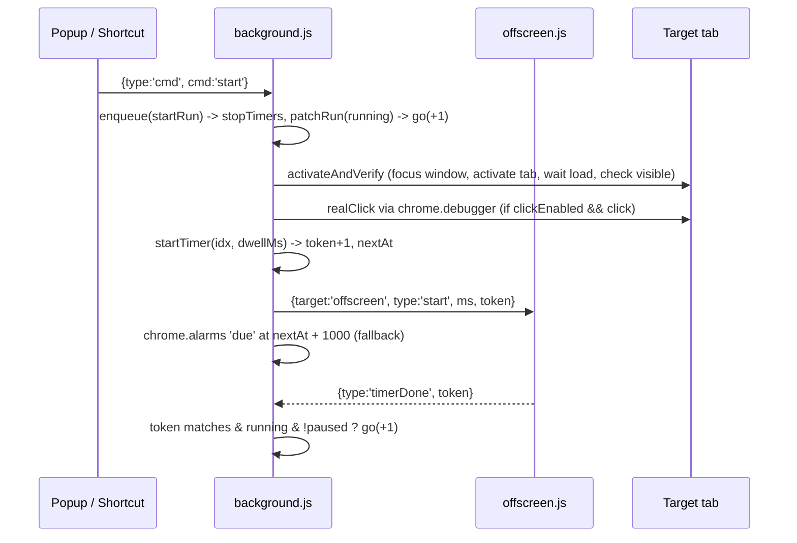

# AGENTS.md — Tab Cycler (codebase guide for AI agents)

> Read this first before editing anything. It describes the structure, runtime flows,
> and every main function per file. `README.md` is the end-user + dev overview;
> this file is the **implementation map**. Keep it in sync when you change code.

---

## 1. What this project is

A **Chrome Manifest V3 extension** (Chrome ≥ 116) that:
1. Rotates through a user-defined sequence of open tabs.
2. Stays on each tab for a dwell time (per-tab or one global time).
3. Optionally performs a **trusted (real) mouse click** at a saved point on each tab via `chrome.debugger` (CDP).

- Plain JavaScript, **no build step, no dependencies, no tests**.
- UI strings and code comments are **Vietnamese** — keep that convention when adding UI text.
- Commits use Conventional Commits (`feat:`, `fix:`, `docs:`, `chore:`).
- Syntax check: `node --check background.js` (one file per call; same for `popup.js`, `offscreen.js`).

---

## 2. Folder structure

```
tab-cycler/
├── manifest.json     # MV3 manifest: permissions, service worker, popup, keyboard commands
├── background.js     # Service worker — ALL runtime logic (state machine, activation, click, timers, events)
├── offscreen.html    # Minimal doc that only loads offscreen.js
├── offscreen.js      # Holds a single setTimeout (survives SW suspension), reports back via message
├── popup.html        # Popup UI markup + inline CSS (light/dark via prefers-color-scheme)
├── popup.js          # Popup logic: edits `config`, sends commands, renders `run` status
├── README.md         # User guide (EN) + developer overview
└── AGENTS.md         # This file
```

### Responsibility split (important)

| Context | Writes `config` | Writes `run` | Notes |
|---|---|---|---|
| `popup.js` | ✅ (directly to storage) | ❌ never | Re-renders on `chrome.storage.onChanged` |
| `background.js` | ✅ only for `pointPicked` (saves click point) | ✅ **sole owner** | All mutations go through `enqueue()` |
| `offscreen.js` | ❌ | ❌ | Stateless except the one timer handle |

---

## 3. manifest.json

| Key | Value / Purpose |
|---|---|
| `permissions` | `tabs` (list/activate/watch), `storage` (state), `alarms` (backup timer), `offscreen` (accurate timer), `scripting` (picker + visibility check), `debugger` (CDP trusted clicks) |
| `host_permissions` | `<all_urls>` — needed for `scripting.executeScript` on any user tab |
| `background.service_worker` | `background.js` (classic script, not module) |
| `action.default_popup` | `popup.html` |
| `commands` | `toggle-pause` = `Alt+Shift+P` (start/pause/resume), `stop-all` = `Alt+Shift+X` |

---

## 4. Persistent state (`chrome.storage.local`)

All state lives in storage because the MV3 service worker can be killed anytime.
Only `busy` / `selfUntil` / `chain` are in-memory (and that's acceptable — they are short-lived guards).

```js
config = {
  items: [{
    tabId, title, url,
    min, sec,                       // per-tab dwell (legacy shape: { value, unit: 's'|'min' })
    clickEnabled: boolean,
    click: { x, y, w, h, xPct, yPct } | null   // pixel coords + viewport size + ratios
  }],
  loop: true,                       // restart at index 0 after last item
  autoPause: true,                  // pause when the USER switches tabs
  timeMode: 'each' | 'all',         // 'all' => use globalMin/globalSec for every item
  globalMin: 0,
  globalSec: 30,
}

run = {
  running: boolean,
  paused: boolean,
  index: number,        // current item index, -1 when idle
  nextAt: number,       // epoch ms when next step is due (0 when paused/stopped)
  remainingMs: number,  // saved on pause, consumed on resume
  token: number,        // incremented on every schedule / pause / stop — invalidates stale timers
  status: string,       // human-readable note (Vietnamese) shown in popup
}
```

Defaults: `DEF_CONFIG` / `DEF_RUN` in [background.js](file:///d:/tab-cycler/background.js#L4-L5).
`DEF_CONFIG` is **duplicated** in [popup.js](file:///d:/tab-cycler/popup.js#L3) — change both together.

---

## 5. Runtime flows

### 5.1 Start → cycle loop



### 5.2 `go(dir)` step logic
1. Read state; if no items → `stopRun`.
2. Set `busy = true`, `selfUntil = now + 3s` (suppress auto-pause on own tab switches).
3. Loop up to `n` times: move `idx += dir`, wrap (or `stopRun` at end if `!loop`).
4. `activateAndVerify(tabId)` → if fail, push note and try next item.
5. If item has click enabled → `realClick` (errors become notes, not failures).
6. `startTimer(idx, dwellMs(item, config), notes)` and return.
7. If every item failed → `stopRun('Không tab nào kích hoạt được')`.

### 5.3 Pause / Resume
- `pause(reason)`: saves `remainingMs = max(1000, nextAt - now)`, clears timers, `token+1`.
- `resume()`: re-activates current tab, sets `paused:false`, `startTimer(index, remainingMs)`.
- `startTimer` called while paused only stores `index/remainingMs` (no timer started).

### 5.4 Click-point picker
```
popup pick(tabId) -> {type:'pick'} -> background startPick
  -> scripting.executeScript(pickerOverlay) into tab
  -> enqueue(pause('Tạm dừng để chọn điểm nhấp'))
  -> focus window + activate tab
page overlay click -> {type:'pointPicked', x,y,w,h,xPct,yPct}
  -> background saves item.click, clickEnabled = true
Esc -> {type:'pickCancelled'}  (no handler in background — ignored)
```
Run stays **paused** after picking; user must resume manually.

### 5.5 Auto-pause & tab-closed
- `tabs.onActivated`: ignored if `busy` or `now < selfUntil`; otherwise if running, not paused, `autoPause` on, and activated tab ≠ current item → `pause('Tự tạm dừng: bạn vừa đổi tab')`.
- `tabs.onRemoved`: if the closed tab is the current item → `go(1)` immediately.

### 5.6 Lifecycle
- `runtime.onStartup` / `onInstalled` → `stopRun('')` (tab IDs don't survive restart). `config` is kept, so old items show as "tab đã đóng" in popup.

---

## 6. Message protocol

| `type` | From → To | Payload | Handler |
|---|---|---|---|
| `cmd` | popup → bg | `cmd: start\|pause\|resume\|stop\|next\|prev` | `handleCmd` (responds `{ok:true}`) |
| `pick` | popup → bg | `tabId` | `startPick` (responds `{ok}` or `{ok:false,error}`) |
| `pointPicked` | page (injected) → bg | `x,y,w,h,xPct,yPct` (tab from `sender.tab.id`) | saves into `config.items[*].click` |
| `pickCancelled` | page → bg | — | **not handled** |
| `start` / `stop` + `target:'offscreen'` | bg → offscreen | `ms, token` | offscreen timer |
| `timerDone` | offscreen → bg | `token` | `go(1)` if token matches |
| `offscreenReady` | offscreen → bg | — | bg re-sends current timer (`nextAt - now`) |

Offscreen ignores any message without `target === 'offscreen'`; background ignores messages with unknown `type` (incl. its own offscreen-targeted broadcasts).

---

## 7. Function reference

### 7.1 [background.js](file:///d:/tab-cycler/background.js) (service worker)

**Globals**
| Name | Purpose |
|---|---|
| `chain` / [`enqueue(fn)`](file:///d:/tab-cycler/background.js#L10-L11) | Promise chain serializing **all** state-changing work. Errors logged with `[TabCycler]`. |
| `busy`, `selfUntil` | In-memory guards so own tab switches don't trigger auto-pause. Only touch them via `asSelf()` (or `startPick`). |
| `sleep(ms)` | Promise delay. |

**State helpers**
| Function | Lines | Description |
|---|---|---|
| [`getState()`](file:///d:/tab-cycler/background.js#L17-L23) | 17–23 | Reads `config` + `run`, merged over defaults. |
| [`patchRun(patch)`](file:///d:/tab-cycler/background.js#L25-L31) | 25–31 | Shallow-merges into `run`, saves, updates badge. Returns new run. |
| [`updateBadge(run)`](file:///d:/tab-cycler/background.js#L33-L39) | 33–39 | Badge `i/n` (green) when running, `II` (amber) when paused, empty when stopped. |
| [`toSec(m, s)`](file:///d:/tab-cycler/background.js#L42) | 42 | Minutes + seconds → total seconds, min 1. **Identical copy in popup.js.** |
| [`dwellSec(it)`](file:///d:/tab-cycler/background.js#L44-L47) | 44–47 | Per-item dwell seconds (ignores mode): `min/sec`, else legacy `value/unit`. **Identical copy in popup.js.** |
| [`dwellMs(it, config)`](file:///d:/tab-cycler/background.js#L49-L50) | 49–50 | Effective dwell in ms: `toSec(globalMin, globalSec)` if `timeMode==='all'`, else `dwellSec(it)`. Mirrors popup `effSec`. |

**Timers**
| Function | Lines | Description |
|---|---|---|
| [`toOffscreen(msg)`](file:///d:/tab-cycler/background.js#L54) | 54 | Sends `{target:'offscreen', ...msg}`; swallows "no receiver" errors. Use for every bg → offscreen message. |
| [`ensureOffscreen()`](file:///d:/tab-cycler/background.js#L56-L68) | 56–68 | Creates offscreen doc (reason `WORKERS`) if none exists; swallows "single/exist" race errors. |
| [`stopTimers()`](file:///d:/tab-cycler/background.js#L70-L73) | 70–73 | Clears alarm `due` and sends `stop` to offscreen. |
| [`startTimer(index, ms, status)`](file:///d:/tab-cycler/background.js#L75-L88) | 75–88 | If paused: store remaining only. Else: `token+1`, set `nextAt`, start offscreen timer + alarm `due` at `nextAt+1000`. |

**Tab activation & clicking**
| Function | Lines | Description |
|---|---|---|
| [`asSelf(fn)`](file:///d:/tab-cycler/background.js#L92-L97) | 92–97 | Runs `fn` with `busy=true`, `selfUntil=now+3s`; on finish `busy=false`, `selfUntil=now+1.5s`. Wrap any self-initiated tab switch with it. |
| [`waitComplete(tabId, timeout)`](file:///d:/tab-cycler/background.js#L99-L107) | 99–107 | Polls every 300ms until tab `complete` and not discarded (15s default). |
| [`checkVisible(tabId)`](file:///d:/tab-cycler/background.js#L109-L119) | 109–119 | Injects `document.visibilityState==='visible'`; returns `null` if not injectable (chrome:// etc.). |
| [`activateAndVerify(tabId)`](file:///d:/tab-cycler/background.js#L122-L151) | 122–151 | Up to 5 attempts: focus/unminimize window, activate tab, verify active, wait load, verify visible. Returns `{ok, note}`; `tab đã đóng` if tab gone. |
| [`realClick(tabId, p)`](file:///d:/tab-cycler/background.js#L154-L184) | 154–184 | Attach debugger 1.3, read viewport; if width ≈ saved (±2px) use pixel `x,y` (y clamped), else scale `xPct/yPct`. Dispatch `mouseMoved → mousePressed → mouseReleased`. Always detaches. |

**Run control**
| Function | Lines | Description |
|---|---|---|
| [`go(dir)`](file:///d:/tab-cycler/background.js#L187-L219) | 187–219 | Core step (see §5.2), body wrapped in `asSelf`. `dir` = `+1` / `-1`. |
| [`startRun()`](file:///d:/tab-cycler/background.js#L221-L227) | 221–227 | Reset run to index -1, then `go(1)`. |
| [`pause(reason)`](file:///d:/tab-cycler/background.js#L229-L235) | 229–235 | See §5.3. No-op if not running or already paused. |
| [`resume()`](file:///d:/tab-cycler/background.js#L237-L244) | 237–244 | See §5.3. |
| [`stopRun(status)`](file:///d:/tab-cycler/background.js#L246-L251) | 246–251 | Clear timers, reset run, `token+1`, close offscreen doc. |

**Picker**
| Function | Lines | Description |
|---|---|---|
| [`pickerOverlay()`](file:///d:/tab-cycler/background.js#L254-L296) | 254–296 | **Injected into the page** (must be self-contained, no closures over SW scope). Full-screen overlay; click → red dot + `pointPicked`; Esc → `pickCancelled`. Guard `window.__tcPicker`. |
| [`startPick(tabId)`](file:///d:/tab-cycler/background.js#L298-L312) | 298–312 | Inject overlay, pause run, focus tab. |

**Event wiring**
| Listener | Lines | Behavior |
|---|---|---|
| [`step(dir)`](file:///d:/tab-cycler/background.js#L316) | 316 | Enqueues `go(dir)` only if running (used by `next`/`prev`). |
| [`handleCmd(cmd)`](file:///d:/tab-cycler/background.js#L318-L327) | 318–327 | Maps commands to enqueued actions. |
| `runtime.onMessage` | 329–364 | Routes message types (see §6). Returns `true` for async `sendResponse`. |
| `alarms.onAlarm` (`due`) | 366–374 | Fallback: `go(1)` only if running, not paused, and `now >= nextAt`. |
| `commands.onCommand` | 376–383 | `stop-all` → stop; `toggle-pause` → start / pause / resume. |
| `tabs.onActivated` | 386–393 | Auto-pause (§5.5). |
| `tabs.onRemoved` | 396–403 | Advance if current tab closed. |
| `runtime.onStartup` / `onInstalled` | 406–407 | Reset run. |

### 7.2 [offscreen.js](file:///d:/tab-cycler/offscreen.js)
- Single `timer` handle. On any `target:'offscreen'` message: `clearTimeout`; if `type==='start'` schedule `timerDone` with the **same token** after `ms`.
- On load: sends `offscreenReady` so background can re-arm the timer.
- [offscreen.html](file:///d:/tab-cycler/offscreen.html) only loads this script.

### 7.3 [popup.js](file:///d:/tab-cycler/popup.js)

**Module state**: `config`, `run` (local mirrors of storage), `openTabs` (from `chrome.tabs.query({})`, loaded once on open).

| Function | Lines | Description |
|---|---|---|
| `$(s)` | 1 | `querySelector` shortcut. |
| [`h(tag, props, ...kids)`](file:///d:/tab-cycler/popup.js#L10-L19) | 10–19 | Safe DOM builder (no `innerHTML` — tab titles are untrusted). `on*` props → listeners. |
| [`fmt(s)`](file:///d:/tab-cycler/popup.js#L21-L29) | 21–29 | Seconds → `"1g 2p 3s"` (giờ/phút/giây). |
| [`toSec(m, s)`](file:///d:/tab-cycler/popup.js#L31) | 31 | Minutes + seconds → total seconds, min 1. **Identical copy in background.js.** |
| [`dwellSec(it)`](file:///d:/tab-cycler/popup.js#L33-L36) | 33–36 | Per-item dwell seconds (handles legacy). **Identical copy in background.js.** |
| [`effSec(it)`](file:///d:/tab-cycler/popup.js#L38) | 38 | Effective seconds respecting `timeMode`. **Mirror of `dwellMs` in background — keep in sync.** |
| [`normTime(m, s)`](file:///d:/tab-cycler/popup.js#L40-L43) | 40–43 | Normalizes min+sec (e.g. 0m 90s → 1m 30s), min 1s. |
| [`load()`](file:///d:/tab-cycler/popup.js#L45-L49) | 45–49 | Load config/run from storage. |
| `saveConfig()` / `cmd(c)` | 50–51 | Persist config / send `{type:'cmd'}`. |
| [`move`, `removeItem`, `addTab`](file:///d:/tab-cycler/popup.js#L53-L63) | 53–63 | Reorder / remove / append item (new item default: `0m 30s`, `clickEnabled:true`, `click:null`). |
| [`pick(tabId)`](file:///d:/tab-cycler/popup.js#L64-L68) | 64–68 | Request picker; show error in `#msg`. |
| [`renderSeq()`](file:///d:/tab-cycler/popup.js#L70-L125) | 70–125 | Render sequence rows: index, title (dead if tab closed), ↑↓✕, time inputs (or "chung" label), click checkbox, pick button, click hint. Highlights current row. |
| [`renderAvail()`](file:///d:/tab-cycler/popup.js#L127-L137) | 127–137 | Open tabs not yet in sequence with `+ Thêm`. |
| [`renderTotal()`](file:///d:/tab-cycler/popup.js#L139-L144) | 139–144 | Total cycle time warning text. |
| [`renderStatus()`](file:///d:/tab-cycler/popup.js#L146-L161) | 146–161 | Button enable states + status line (countdown from `nextAt`). Called every 500ms. |
| [`renderMode()`](file:///d:/tab-cycler/popup.js#L163-L170) | 163–170 | Time-mode radios + global time box. |
| `render()` | 172 | Calls all renderers. |
| Control handlers | 174–192 | Buttons → `cmd(...)`; `loop`, `autoPause`, mode, global time → save config. |
| `storage.onChanged` | 194–207 | Sync mirrors; **skips full re-render while user is typing** in a number input. |
| Init IIFE | 209–216 | load → query tabs → set checkboxes → render → `setInterval(renderStatus, 500)`. |

### 7.4 [popup.html](file:///d:/tab-cycler/popup.html)
Element IDs used by `popup.js`: `#status`, `#note`, `#prev`, `#start`, `#pause`, `#stop`, `#next`, `#modeEach`, `#modeAll`, `#globalBox`, `#gMin`, `#gSec`, `#seq`, `#loop`, `#autoPause`, `#total`, `#avail`, `#msg`.
CSS uses variables in `:root` with a dark-mode override; row classes `.row`, `.current`, `.dead`.

---

## 8. Invariants & rules for agents

1. **Every state mutation in background must go through `enqueue()`.** Don't call `go/pause/resume/stopRun` directly from listeners.
2. **Only background writes `run`.** Popup must send `cmd` messages instead.
3. **Bump `run.token`** whenever you invalidate a scheduled step (schedule, pause, stop). Any timer callback must check the token.
4. **Wrap self-initiated tab switches in `asSelf()`** (sets `busy`/`selfUntil`), or auto-pause will misfire.
5. **Functions passed to `scripting.executeScript` (`pickerOverlay`, the visibility check) are serialized** — no references to outer variables/functions.
6. **Duplicated logic (intentionally kept per-file, no shared module)**: `DEF_CONFIG`, `toSec`, `dwellSec` are identical copies in `background.js` and `popup.js`; `dwellMs` ↔ `effSec` mirror each other. Update both. Send offscreen messages only via `toOffscreen()`.
7. Keep legacy item shape `{ value, unit }` readable (popup migrates to `min/sec` on edit).
8. Never use `innerHTML` with tab titles/URLs in popup — use `h()`.
9. New UI text in Vietnamese; update the translation table in `README.md` if you add visible labels.
10. After adding a permission, update the permissions tables in `README.md` and §3 here.

## 9. Known limitations / gotchas
- Tab IDs aren't re-matched after browser restart (no URL matching).
- `openTabs` in popup is loaded only on popup open (no live tab list).
- `pickCancelled` is sent but not handled; run stays paused after picking either way.
- Chrome shows the "started debugging this browser" infobar on every click (CDP restriction).
- `tabs.onActivated` reads state outside the queue (only the resulting `pause` is enqueued).
- `updateBadge` calls `getState()` again (extra storage read per `patchRun`).
