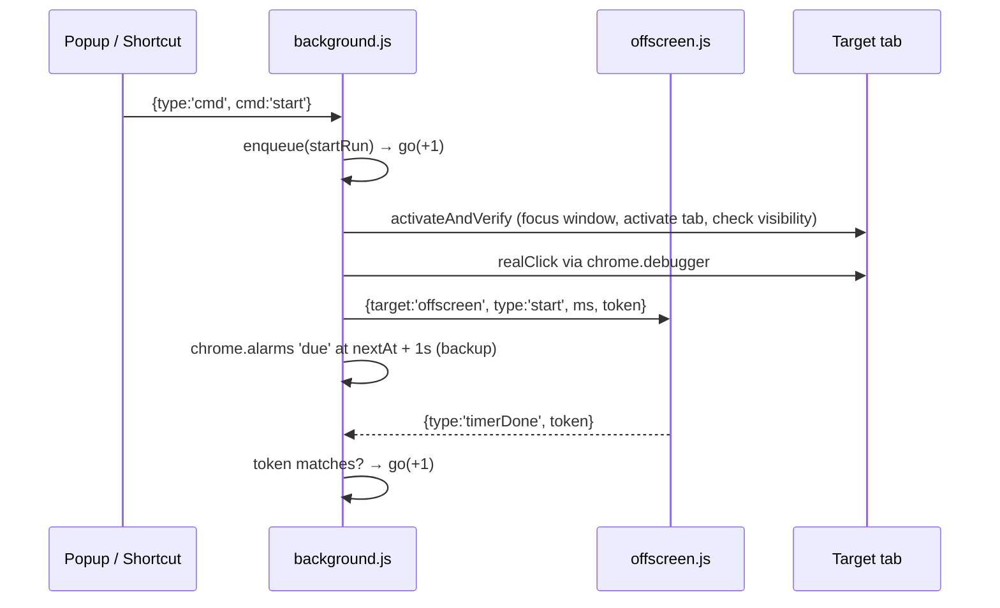

# Tab Cycler

A Chrome extension that **automatically rotates through your browser tabs**, stays on each one for as long as you choose, and can **click a spot on the page for you** every time it arrives.

> Typical use: keep several dashboards, admin panels or web apps "alive" so they don't log you out from inactivity, or show a rotating set of pages on a monitor.

---

## Part 1 — For everyone (no technical knowledge needed)

### What does it do?

1. You pick which open tabs to include and put them in order.
2. For each tab you set how long to stay there (minutes + seconds, e.g. **1 min 30 s**).
3. Optionally, you choose a spot on that page to be clicked automatically (e.g. a "Refresh" or "Stay logged in" button).
4. Press **Start**. The extension switches to tab 1, clicks your spot, waits, moves to tab 2, and so on. When it reaches the end it starts over (or stops — your choice).

### Installing it

The extension is not in the Chrome Web Store, so you load it manually. It takes about a minute:

1. Download or copy this folder to your computer (e.g. `D:\tab-cycler`).
2. Open Chrome and go to `chrome://extensions`.
3. Turn on **Developer mode** (switch in the top-right corner).
4. Click **Load unpacked** and select the folder.
5. A "Tab Cycler" icon appears in the toolbar. Click the puzzle-piece icon and **pin** it so it's always visible.

Requires Chrome 116 or newer (also works in Edge, Brave and other Chromium browsers).

### Using it

Click the toolbar icon to open the panel. The interface is in Vietnamese; here is what each part means:

| On screen | Meaning |
|---|---|
| **Bắt đầu** | Start |
| **Tạm dừng / Tiếp tục** | Pause / Resume |
| **Dừng** | Stop completely |
| **⏮ / ⏭** | Go to previous / next tab now |
| **Chuỗi chạy** | Your sequence (the tabs that will rotate) |
| **Tab đang mở** → **+ Thêm** | Open tabs → Add to sequence |
| **Dừng _ phút _ giây** | Stay for _ minutes _ seconds |
| **Nhấp** (checkbox) | Click automatically on this tab |
| **Chọn điểm / Đổi điểm** | Choose / change the click spot |
| **↑ ↓ ✕** | Move up / move down / remove |
| **Lặp lại vòng** | Loop forever |
| **Tự tạm dừng khi tôi đổi tab** | Auto-pause when I switch tabs myself |

**Step by step:**

1. Under **Tab đang mở**, click **+ Thêm** next to each tab you want.
2. In **Chuỗi chạy**, set the minutes and seconds for each tab. Use ↑ ↓ to reorder.
3. To auto-click: press **Chọn điểm**. The tab opens with a blue overlay — click the exact spot you want. A red dot confirms it was saved. Press **Esc** to cancel.
4. Press **Bắt đầu** (Start).

The badge on the icon shows progress, e.g. `2/5` (on tab 2 of 5) or `II` (paused).

### Keyboard shortcuts

| Keys | Action |
|---|---|
| `Alt + Shift + P` | Start / Pause / Resume |
| `Alt + Shift + X` | Stop |

You can change these at `chrome://extensions/shortcuts`.

### Good to know

- **"Tab Cycler started debugging this browser" bar** — Chrome shows this briefly whenever the extension performs a click. This is normal: it's how the extension produces a *real* mouse click that websites accept.
- **If you switch tabs yourself** while it's running, it pauses automatically (you can turn this off). Press Resume to continue.
- **If a tab in the list is closed**, it is skipped. Closed tabs appear faded with "tab đã đóng" (tab closed).
- **After restarting Chrome**, tabs get new internal IDs, so your old list will show as closed. Remove them and add the tabs again.
- **Total cycle time** is shown under the list. If you're using this to avoid auto-logout, keep the total shorter than the site's timeout, since each tab is visited once per cycle.
- Some pages can't be clicked or controlled (e.g. `chrome://` pages, the Chrome Web Store). They will still be shown, just without the click.
- Your computer must stay awake and Chrome must be open.

---

## Part 2 — For developers

### Stack

Plain JavaScript, Chrome **Manifest V3**, no build step and no dependencies.

### Files

| File | Role |
|---|---|
| `manifest.json` | MV3 manifest: permissions, service worker, popup, commands |
| `background.js` | Service worker — all runtime logic (state machine, tab activation, clicking, timers, event handling) |
| `offscreen.html` / `offscreen.js` | Offscreen document that only holds a `setTimeout`, so the timer is not lost when the service worker is suspended |
| `popup.html` / `popup.js` | UI — edits the sequence config and sends commands |

### Permissions and why

| Permission | Used for |
|---|---|
| `tabs` | Listing, activating and watching tabs |
| `storage` | Persisting config and run state |
| `alarms` | Backup timer in case the offscreen timer is delayed |
| `offscreen` | Accurate timer that outlives the service worker |
| `scripting` | Injecting the click-point picker and a visibility check |
| `debugger` | Sending trusted mouse events via CDP `Input.dispatchMouseEvent` |
| `<all_urls>` | Allows scripting on any site the user adds |

### State (`chrome.storage.local`)

All state lives in storage because an MV3 service worker can be killed at any moment.

```js
config = {
  items: [{
    tabId, title, url,
    min, sec,                 // dwell time (legacy: value + unit 's'|'min')
    clickEnabled,
    click: { x, y, w, h, xPct, yPct } | null
  }],
  loop: true,
  autoPause: true
}

run = {
  running, paused,
  index,        // current item
  nextAt,       // epoch ms when the next step is due
  remainingMs,  // saved on pause
  token,        // incremented on every (re)schedule / pause / stop
  status        // human-readable note shown in the popup
}
```

The popup writes `config` directly. Only the background writes `run`. The popup re-renders on `chrome.storage.onChanged`.

### Run loop



### Key design points

- **Serialized queue** — every action (commands, timer callbacks, alarms, tab events) goes through `enqueue()`, a promise chain, so there are no races.
- **Two-layer timer** — the offscreen `setTimeout` is primary; a `chrome.alarms` alarm fires 1 s later as a fallback and does nothing if the step already advanced.
- **Tokens** — every schedule, pause or stop increments `run.token`. Late `timerDone` messages with an old token are ignored.
- **Offscreen recovery** — when the offscreen document (re)loads it sends `offscreenReady`, and the background re-sends the current timer.
- **Activation with verification** — `activateAndVerify()` focuses and un-minimizes the window, activates the tab, waits for discarded/loading tabs, and checks `document.visibilityState`. It retries up to 5 times; tabs that still fail are skipped.
- **Trusted clicks** — `realClick()` attaches the debugger, reads the viewport size, and sends `mouseMoved → mousePressed → mouseReleased`. If the viewport width is unchanged (±2 px) it uses the original pixel coordinates; otherwise it scales by the saved percentages.
- **Self-inflicted events** — `busy` / `selfUntil` stop `tabs.onActivated` from treating the extension's own tab switches as user activity (which would trigger auto-pause).
- **Lifecycle** — `onStartup` / `onInstalled` reset the run state because tab IDs do not survive a browser restart.

### Message types

| `type` | Direction | Purpose |
|---|---|---|
| `cmd` (`start`, `pause`, `resume`, `stop`, `next`, `prev`) | popup → background | Control the run |
| `pick` | popup → background | Inject the click-point picker into a tab |
| `pointPicked` / `pickCancelled` | page → background | Result of the picker |
| `start` / `stop` (`target: 'offscreen'`) | background → offscreen | Schedule or cancel the timer |
| `timerDone` | offscreen → background | Timer fired |
| `offscreenReady` | offscreen → background | Offscreen document loaded |

### Developing

1. Load the folder via **Load unpacked** (see above).
2. After editing, press **Reload** on the extension card at `chrome://extensions`.
3. Debug the background via the **service worker** link on the card; debug the popup by right-clicking it → **Inspect**.
4. Quick syntax check (one file per call): `node --check background.js`, `node --check popup.js`, `node --check offscreen.js`.

Commits follow [Conventional Commits](https://www.conventionalcommits.org/) (`feat:`, `fix:`, `docs:`, `chore:` …).

### Known limitations

- Tab IDs are not re-matched after a browser restart (e.g. by URL).
- The popup's list of open tabs is loaded only when the popup opens.
- After picking a click point the run stays paused until resumed manually.
- The debugger infobar appears on every click; that's a Chrome restriction.
